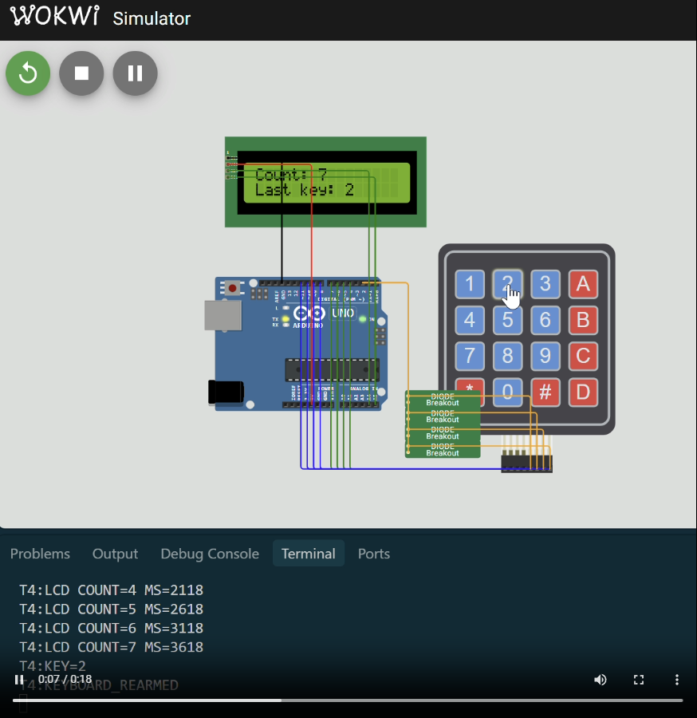

# Лабораторная работа №3 — внешние и внутренние прерывания

[Отчёт PDF](report.pdf) · [Исходный код](src/) · [Схемы Wokwi](circuits/) · [Ответы на вопросы](questions.md)

> Для нумерации используется исходное имя выданного файла (`N3`). Напечатанный внутри PDF номер 4 не совпадает с именем файла и последовательностью комплекта.

## Что реализовано

1. **Внешнее прерывание INT0:** кнопка D2 переключает мигание LED D13 между 1 и 5 полными циклами в секунду. Режим меняется только в ISR; антидребезг сочетает 120 мс устойчивого отпускания и 300 мс между принятыми нажатиями.
2. **Timer1, 100 Гц:** CTC, предделитель 64, `OCR1A=2499`. ISR меняет состояние D13 каждые 10 мс. Частота прерываний равна 100 Гц, полный цикл LED — 50 Гц.
3. **Timer0 и клавиатура 4×4:** Compare A срабатывает каждые 1,024 мс, в каждом ISR сканируется одна строка. Три совпавших чтения подавляют дребезг; найденная клавиша печатается в Serial вне ISR.
4. **INT0 + Timer1 + I2C LCD:** Timer1 раз в 500 мс просит обновить счётчик на LCD, а диодная схема ИЛИ подаёт активность клавиатуры на D2. Внешняя ISR только ставит флаг; полное сканирование и I2C выполняются в `loop()`.

## Подключение

| Задание | Компонент | Пины Arduino Uno |
|---|---|---|
| 1 | Кнопка / LED | D2 (INT0) / D13 |
| 2 | LED | D13 (PB5) |
| 3 | Строки / столбцы клавиатуры | D4–D7 / D8–D11 |
| 4 | Клавиатура / общий IRQ / LCD | D4–D11 / D2 / A4 SDA, A5 SCL |

Для задания 4 Wokwi загружает маленькую открытую цифровую модель `chip-diode`, потому что встроенного аналогового диода у симулятора нет. Модель распространяет LOW от вывода с именем `ANODE` к `CATHODE`, поэтому её подписи не являются физической полярностью этой схемы. На макете нужны четыре 1N4148: общие аноды подключаются к подтянутому D2, катоды — к C1–C4.

## Реально проверено

| Скетч | Flash | SRAM | Wokwi |
|---|---:|---:|---|
| `task1_external_button` | 3224 Б (9%) | 208 Б (10%) | NORMAL → FAST → NORMAL, дребезг не создаёт повторов |
| `task2_timer1_100hz` | 2210 Б (6%) | 192 Б (9%) | 100 тиков за 999 мс, затем 200 тиков |
| `task3_keypad_timer0` | 2720 Б (8%) | 249 Б (12%) | клавиша `5` распознана, сценарий завершён |
| `task4_lcd_keypad` | 7094 Б (21%) | 467 Б (22%) | LCD 500 мс, клавиша `5`, повторное взведение INT0 |

## Как собрать

Из корня репозитория:

```powershell
arduino-cli compile --fqbn arduino:avr:uno --output-dir build/lab03/task1_external_button lab03/src/task1_external_button
arduino-cli compile --fqbn arduino:avr:uno --output-dir build/lab03/task2_timer1_100hz lab03/src/task2_timer1_100hz
arduino-cli compile --fqbn arduino:avr:uno --output-dir build/lab03/task3_keypad_timer0 lab03/src/task3_keypad_timer0
arduino-cli compile --fqbn arduino:avr:uno --output-dir build/lab03/task4_lcd_keypad lab03/src/task4_lcd_keypad
```

### Запуск Wokwi двойным щелчком

Запустите [`open-wokwi.cmd`](open-wokwi.cmd). Откроется отдельное окно VS Code с исходным кодом задания 4 и его готовой схемой Wokwi. В редакторе схемы нажмите зелёную кнопку запуска — нужные `diagram.json`, `wokwi.toml`, HEX и ELF уже связаны между собой.

Если расширение сообщает `Your Wokwi license has expired`, сначала нажмите **Request a New License** и завершите активацию. Токен Wokwi CLI не заменяет лицензию расширения VS Code.

Ручной вариант: откройте нужную папку из `lab03/circuits`, выберите её `wokwi.toml` командой **Wokwi: Select Config File**, затем выполните **Wokwi: Start Simulator**.

## Исправления методички

- Timer0 создаёт внутреннее, а не внешнее прерывание.
- `OCR1A=2499` при 16 МГц и делителе 64 действительно даёт 100 Гц.
- Переключение LED каждым 100-Гц прерыванием даёт 50 полных световых циклов в секунду.
- Для периода 500 мс с Timer1 и делителем 1024 нужно `OCR1A≈7812`. Указанное в примере `30517` дало бы примерно 1,953 с.
- Timer0 оставлен в стандартном режиме Arduino; Compare A с `OCR0A=249` возникает раз в 1,024 мс и не ломает `millis()`.

## Демонстрация

[Короткое видео задания 4](media/lab03-demo.mp4) — реальная 18,47-секундная запись интерактивной симуляции Wokwi. В кадре видны Arduino Uno, LCD, матричная клавиатура, соединения и Serial. Показаны рост счётчика, нажатия `2`, `0`, `*`, `1`, изменение `Last key` и повторное взведение INT0 после отпускания.




Отдельной кнопки сброса по методичке нет: счётчик обнуляется при перезапуске микроконтроллера или симуляции. Автоматические доказательства остальных заданий сохранены в локальных журналах проверки.
