# Лабораторная работа №2: конечный автомат светофора двумя методами

## Постановка и одинаковая спецификация

Реализованы две самостоятельные прошивки Arduino Uno: `switch_fsm` (классический `switch-case`) и `table_fsm` (двумерная таблица обработчиков `state x event`). Обе используют: D13 red, D12 yellow, D11 green; D2 pedestrian, D3 emergency, D4 night. Кнопки active-low с `INPUT_PULLUP`.

Нормальный цикл: Green 10 s -> Yellow 3 s -> Red 10 s -> Green. Пешеходный запрос, полученный вне emergency, запоминается; текущий Green заканчивается штатно через Yellow, затем Red длится 15 s. Все таймеры неблокирующие (`millis()`), debounce D2/D4 равен 50 ms.

Emergency имеет высший приоритет: немедленно включает мигающий Yellow. При входе в special mode программа сохраняет normal state и оставшееся время. После снятия emergency она продолжает сохранённую нормальную фазу с оставшимся временем. Night включается D4, также мигает Yellow с периодом 1 s; если emergency активен, переключение night только запоминается, emergency остаётся приоритетным. Pedestrian во время emergency сознательно игнорируется и логируется как `PED_IGNORED_EMERGENCY`.

```mermaid
stateDiagram-v2
  GREEN --> YELLOW: timer / ped queued
  YELLOW --> RED: timer; Red=15s if ped
  RED --> GREEN: timer
  GREEN --> EMERGENCY: emergency on
  YELLOW --> EMERGENCY: emergency on
  RED --> EMERGENCY: emergency on
  EMERGENCY --> GREEN: emergency off, restore
  GREEN --> NIGHT: night on
  NIGHT --> GREEN: night off, restore
```

## Архитектуры

В `switch_fsm/switch_fsm.ino` normal state обрабатывается прямым `switch(state)`. В `table_fsm/table_fsm.ino` определена настоящая `Handler table[STATE_COUNT][EVENT_COUNT]`: строка - Green/Yellow/Red, столбец - timer/pedestrian; цикл вызывает `table[state][event]()`. Это не косметический switch. В special modes общая логика приоритета и восстановления одинаковая, поэтому поведение эквивалентно.

## Схемы и запуск

Wokwi-схемы: `../switch_fsm/diagram.json`, `../table_fsm/diagram.json`. Визуально: двойной щелчок `../open-switch-wokwi.cmd` либо `../open-table-wokwi.cmd`; затем в VS Code `F1 -> Wokwi: Start Simulator`. Команды CLI: `./scripts/build.ps1 -Lab lab02 -Sketch switch_fsm` и `./scripts/build.ps1 -Lab lab02 -Sketch table_fsm`.

## Реальные результаты

| Показатель | switch-case | table-driven |
|---|---:|---:|
| Flash | 4400 B (13%) | 4460 B (13%) |
| SRAM | 422 B (20%) | 434 B (21%) |
| Итог | меньше на 60 B Flash и 12 B SRAM | больше из-за таблицы указателей |

Логи реальной сборки: `artifacts/build-logs/lab02-switch_fsm-20261024-124848.log`, `artifacts/build-logs/lab02-table_fsm-20261024-124852.log`.

`wokwi-cli lint` успешно проверил обе схемы. Штатные Wokwi-прогоны обоих вариантов успешно завершили YAML-сценарии и дали: `MS=0 Green DUR=10000`, `MS=10000 Yellow DUR=3000`, `MS=13000 Red DUR=10000`; логи `results/switch-normal.log`, `results/table-normal.log`.

Отдельные успешные Wokwi-сценарии обоих вариантов подтвердили emergency on, emergency-off restore и night on/off: `results/switch-events.log`, `results/table-events.log`. Ускоренные pedestrian/debounce прогоны в обоих случаях дали Serial: единственный `PED_QUEUED`, Yellow 300 ms, `TIMER_PED DUR=1500`, затем Green; логи `switch-ped-debounce.log`, `table-ped-debounce.log`. YAML runner завершил эти два прогона timeout 42 после уже записанных переходов из-за ограничения Wokwi automation после `write-serial`; это не считается успешным статусом сценария, но наблюдаемый Serial-результат сохранён и одинаков у обеих прошивок.

## Вывод

Обе функциональные реализации собраны, визуализируются в Wokwi и подтверждены реальными симуляциями. В данной конкретной сборке switch-case экономичнее. Ограничения: Wokwi не заменяет физическую Arduino, а механический дребезг кнопок моделируется только программными импульсами; два ускоренных сценария имеют timeout runner при сохранённых наблюдаемых логах.
